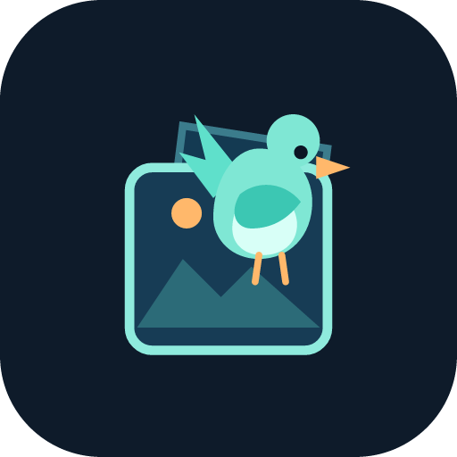
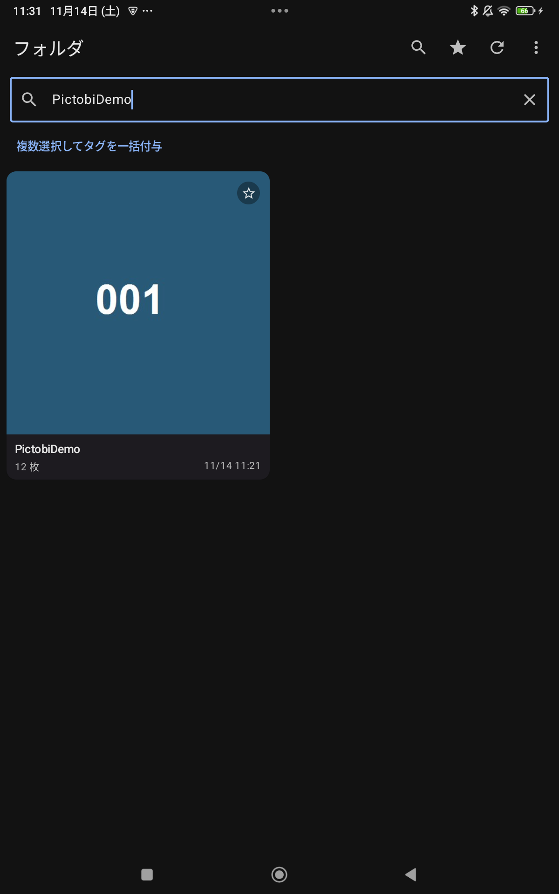
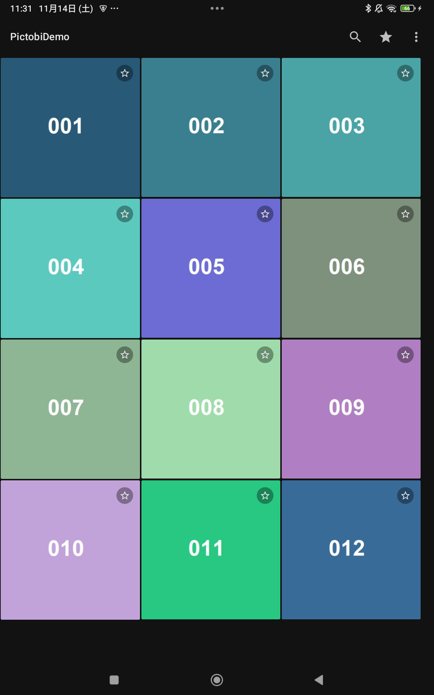
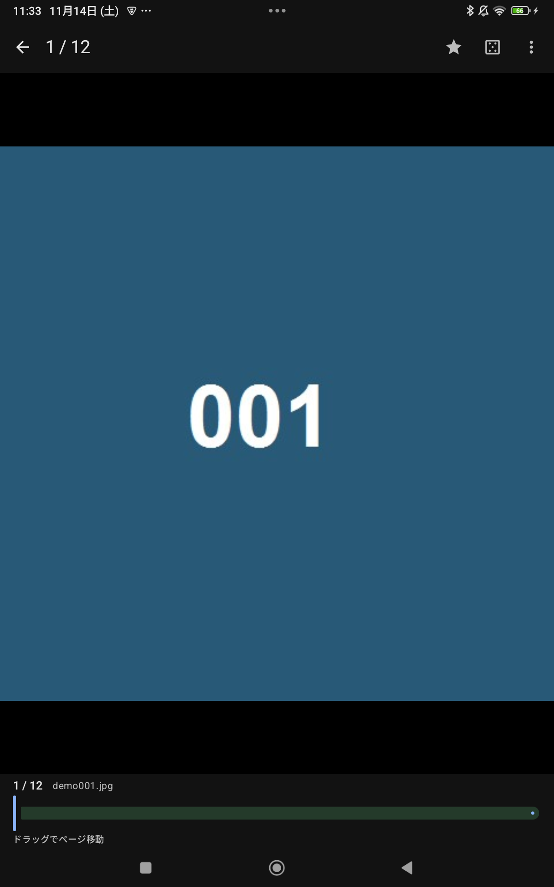

<div align="center">



# Pictobi

**大量の画像を、フォルダ単位で待たされずに見る。**

Android 向けのオープンソース画像ビューア。35万枚規模のライブラリでも、
起動・復帰・戻る操作で一覧が消えないことを最優先に設計しています。

[](https://github.com/tonbiattack/fastest-picture-viewer/actions/workflows/android.yml)
[](https://github.com/tonbiattack/fastest-picture-viewer/releases/latest)
[](LICENSE)
[](https://developer.android.com/about/versions/10)

[ダウンロード](https://github.com/tonbiattack/fastest-picture-viewer/releases/latest) ·
[ドキュメント](docs/) ·
[Issues](https://github.com/tonbiattack/fastest-picture-viewer/issues)

</div>

  

> スクリーンショットは検証用のサンプル画像で撮影しています。

## 特徴

- **待たせない** — Room のキャッシュを即座に表示し、更新はバックグラウンドで行う。更新開始で一覧を空にしない
- **戻っても消えない** — 画面遷移・アプリ復帰・プロセス再生成後も一覧と閲覧位置を復元する
- **大量画像に耐える** — 35万枚規模（2026-11-16 計測時点 353,770 枚 / 2,667 フォルダ）で実機検証。MediaStore の世代番号で差分のみ走査する
- **オフライン完結** — ネットワーク権限なし。画像も閲覧履歴も端末外へ送らない
- **広告・課金・アカウントなし** — 無料。署名済み APK の直接配布と Google Play の両方に対応

## インストール

Google Play と GitHub Releases の両方から入手できます。

### Google Play から

（公開準備中。公開後はストアのリンクをここに載せます）

### APK を直接インストール

1. [Releases](https://github.com/tonbiattack/fastest-picture-viewer/releases/latest) から `Pictobi-<version>.apk` をダウンロード
2. 「設定 → セキュリティ」で、使ったブラウザ/ファイルアプリの「提供元不明のアプリ」を許可
3. APK をタップしてインストール
4. 起動して「写真と動画の閲覧」を許可

> **注意:** Google Play 版と GitHub Releases 版は**署名が異なります**。
> 一方から他方へ上書きインストールすることはできません。
> 乗り換える場合は、先にバックアップを書き出してください（アンインストールでデータが消えます）。

既に Pictobi を入れている場合は、上書きインストールでデータを保持したまま更新できます。

<details>
<summary>PC から入れる場合（adb）</summary>

```bash
adb install -r Pictobi-<version>.apk
```

</details>

> **注意:** 署名の異なる APK は上書きできません（`INSTALL_FAILED_UPDATE_INCOMPATIBLE`）。
> 各リリースの SHA-256 を照合してから導入すると安全です。

## 主な機能

| カテゴリ | 機能 |
| --- | --- |
| 閲覧 | フォルダ一覧 / 画像グリッド / 画像ビューア（スワイプ・ピンチ・ダブルタップ）。前後画像を先読みしてスワイプを滑らかにする |
| 整理 | お気に入り（フォルダ・画像）、タグ付けとタグ絞り込み、除外フォルダ |
| 検索 | フォルダ名・ファイル名の絞り込み（大文字小文字を無視）。ヘッダー直下の 1 行バーで、一覧の表示領域を削らない |
| 移動 | ページスクラバー、高速スクローラー、ワンタップで先頭へ、ランダムジャンプ、前後フォルダ移動 |
| 表示 | 列数変更（1〜4 / 2〜6列）、縦横別の列数、ピンチで一時変更、常時ダーク |
| 継続性 | スクロール位置・閲覧位置の復元、起動時の「前回の続き」カード |
| その他 | 画像の共有・情報表示、自然順ソート、没入型全画面 |
| バックアップ | タグ・お気に入り・除外フォルダ・表示設定を JSON へ書き出し / 復元 |

## 動作環境

| 項目 | 内容 |
| --- | --- |
| 対応 OS | Android 10（API 29）以上 |
| 動作確認端末 | OPPO Reno13 A（CPH2699 / Android 16 / ColorOS 16.0.5） |
| 必要権限 | 写真と動画の閲覧（`READ_MEDIA_IMAGES` / Android 12 以前は `READ_EXTERNAL_STORAGE`） |
| ネットワーク | 不使用（完全オフライン） |

権限を拒否してもキャッシュ済みの一覧は表示され、案内バナーが出ます。

## 技術スタック

Kotlin · Jetpack Compose · Room · Coil · MediaStore · Coroutines/Flow

メタデータは Room、サムネイルはディスク、表示中と前後の画像は RAM に置きます。
元画像を丸ごと RAM に保持しない設計です。

## ビルド

Android SDK（compileSdk 36）と JDK 17 以上が必要です。

```bash
./gradlew :app:testDebugUnitTest   # 単体テスト
./gradlew :app:assembleDebug       # デバッグ APK
./gradlew :app:lintDebug           # lint
```

Windows では環境確認からテスト・ビルドまでスクリプトでまとめて実行できます。

```powershell
powershell -ExecutionPolicy Bypass -File scripts\build-and-test.ps1
```

実機（OPPO Reno13 A）での導入・計測は `scripts\device.ps1` を使います。
詳細は [ビルド環境](docs/build-environment.md) / [スクリプト一覧](docs/scripts.md)。

## 品質

- **テスト:** Robolectric による Room DAO、移行、同期ポリシー、読み取り検証、ViewModel、純粋ロジック
- **CI:** push / pull request で単体テストと debug ビルドを自動実行
- **実機検証:** 画像 353,770 件・フォルダ 2,667 件（2026-11-16 計測）の環境で起動・復帰を確認。100往復の画面遷移は 350,955 件（2026-11-10 計測）で失敗 0
- **起動時間:** キャッシュありコールド起動 P50 1,847ms / P95 2,069ms（実機 20 回、2026-11-16 00:36 計測 / #106 完了時。35万枚規模。参考目標 200ms は未達）
  - 2026-11-16 10:25 の再計測では P50 **2,436ms** で、#106 完了時から約 590ms 悪化していた（原因は未特定のまま）
  - #110 で代表サムネイルの二重描画を解消し、同日 11:00 の再計測で P50 **2,277ms** まで戻した。**最新値は 2,277ms**（目標 1,000ms は未達）

**検証規模の基準:** 2026-11-16 計測時点で MediaStore 画像 **353,770 枚** / フォルダ **2,667**（`external_primary` と SD カード `eeff-78c9` の 2 ボリューム）。
フォルダ数は MediaStore の distinct `bucket_id` の数で、除外フォルダと読み取り不可の画像を差し引く前の値です。
計測日・条件の異なる過去の実測値は [実機検証](docs/device-verification.md) と [性能計測](docs/benchmark.md) に日付付きで残しています。

## 既知の制限

- SD カードの抜き差し・切断時の挙動は未検証
- 権限を拒否した状態ではキャッシュ表示のみ
- 画像の削除・移動は行わない（端末の標準ギャラリーを使う）
- 端末の買い替えでお気に入り・タグは自動では引き継がれない →
  **メニューの「バックアップ」から JSON へ書き出して復元できます**
- 他機種での網羅的な動作保証はしない

## コントリビューション

Issue・Pull Request を歓迎します。

- バグ報告・要望は [Issues](https://github.com/tonbiattack/fastest-picture-viewer/issues) へ
- 変更は `main` から `feature/<topic>` / `fix/<topic>` の短命ブランチを切って PR を送ってください
- PR を出す前に `./gradlew :app:testDebugUnitTest :app:lintDebug` が通ることを確認してください
- 実機でしか確認できない項目は、確認した端末と結果を PR に書いてください

開発方針とブランチ運用は [AGENTS.md](AGENTS.md) にまとめています。

## ドキュメント

| ドキュメント | 内容 |
| --- | --- |
| [仕様書](docs/specification.md) | 機能要件・データ設計・受け入れ条件 |
| [実機検証](docs/device-verification.md) | 検証項目・実測値・未実施項目 |
| [性能計測](docs/benchmark.md) | 起動・復帰・スワイプの計測方法と実測値 |
| [APK の導入・更新](docs/install-and-update.md) | インストールとトラブルシューティング |
| [リリース手順](docs/release.md) | 署名・タグ・GitHub Releases |
| [署名鍵の運用](docs/signing-policy.md) | 鍵の作成・保管・バックアップ |
| [ビルド環境](docs/build-environment.md) | Windows 11 のセットアップ |
| [スクリプト](docs/scripts.md) | ビルド・実機操作・UI 補助 |
| [UX バックログ](docs/ux-backlog.md) | 採用・保留・不採用の判断 |

## プライバシー

端末内の画像をオフラインで閲覧します。解析 SDK・広告・トラッキングは含みません。

Auto Backup は巨大な Room DB（実機で約 295MB）が上限を超えるため対象から除外し、
列数・並び順・前回の続きなどの設定のみをバックアップします。

| データ | バックアップ |
| --- | --- |
| 設定（列数・並び順・前回の続きなど） | 対象 |
| 画像メタ情報・お気に入り・タグ（Room DB） | 対象外（サイズ超過のため） |
| サムネイルのキャッシュ | 対象外（再生成できる） |

端末を買い替えると設定は引き継げますが、お気に入り・タグは引き継げません。
**メニューの「バックアップ」から JSON に書き出しておけば、新しい端末で復元できます。**

### 手動バックアップ（推奨）

Room DB はサイズが大きいため Auto Backup の対象外です。代わりに:

1. フォルダ一覧のメニュー → **バックアップ**
2. **バックアップを書き出す** → 保存先を選ぶ
3. 復元するときは **バックアップから復元** → ファイルを選ぶ → 内容を確認して取り込む

新規利用時など DB がまだない場合は、起動時にも復元を案内します。**ファイルの検出や復元は自動では行いません。**
「バックアップを選ぶ」から画面を開き、ファイルを選んで内容を確認してください。「あとで」を選んだ場合も、メニューから復元できます。
再インストール・別端末では保存先を再選択する必要があります。通常の更新では案内を出しません。

- タグ・お気に入り（フォルダ/画像）・除外フォルダ・表示設定が入ります
- 写真そのもの、スクロール位置、「前回の続き」の履歴は含まれません
- タグ・お気に入り・除外は**追加マージ**ですが、表示設定はバックアップの値で上書きされます
- 復元先で画像 URI が変わると画像のお気に入りが元の画像を指せない場合があります

#### 書き出し忘れの防止

バックアップ画面に**最終書き出し日時**を表示します。一度も書き出していない場合はその旨を出します。

タグ・お気に入り・除外を変更したあと、前回の書き出しから 30 日経つと、フォルダ一覧に
控えめなバナーで書き出しを促します。**起動をブロックするダイアログは出しません。**
変更が無いときは催促しません。「あとで」を選ぶと 7 日間は出ません。
- 定期的に書き出し、PC やクラウドへ退避しておくと安全です

## ライセンス

[MIT License](LICENSE)

使用しているオープンソースライブラリ（いずれも Apache License 2.0）:
AndroidX、Jetpack Compose、Room、Kotlin Coroutines、Coil。

「最速」は本プロジェクトの設計方針であり、他アプリとの比較ベンチマークは未実施です。
